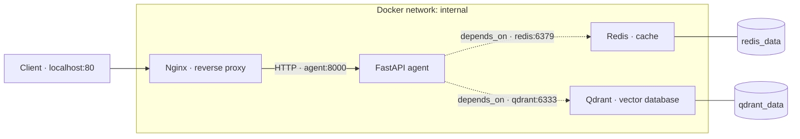

# Day 14 Lab - Mission Answers

## Part 1 — Localhost vs Production

### Exercise 1.1 — Các anti-pattern trong bản develop

1. [Dòng 17–18](01-localhost-vs-production/develop/app.py#L17) ghi cứng API key và URL cơ sở dữ liệu có thông tin đăng nhập. Credential thật có thể lộ trong repo và lịch sử Git.
2. [Dòng 33–38](01-localhost-vs-production/develop/app.py#L33) dùng `print()` để in câu hỏi, câu trả lời và cả API key. Log bị thu thập tập trung có thể làm lộ nội dung người dùng và secret.
3. [Dòng 21–22](01-localhost-vs-production/develop/app.py#L21) đặt cứng `DEBUG` và `MAX_TOKENS`. Muốn đổi các giá trị này giữa các môi trường phải sửa mã nguồn.
4. [Dòng 51–52](01-localhost-vs-production/develop/app.py#L51) chỉ bind vào `localhost` và cố định cổng `8000`. Nền tảng có thể cấp cổng khác, còn địa chỉ loopback chỉ nhận kết nối trong cùng máy hoặc container.
5. [Dòng 53](01-localhost-vs-production/develop/app.py#L53) luôn bật `reload=True`. Uvicorn theo dõi file và có thể khởi động lại worker khi file thay đổi.
6. [Dòng 42–43](01-localhost-vs-production/develop/app.py#L42) ghi nhận app thiếu `/health`. App cũng thiếu `/ready`, nên hệ thống điều phối thiếu tín hiệu để phân biệt tiến trình còn sống với instance đã sẵn sàng nhận traffic.
7. [Dòng 13](01-localhost-vs-production/develop/app.py#L13) tạo FastAPI app mà không khai báo `lifespan`. Uvicorn vẫn quản lý việc dừng server, nhưng ứng dụng chưa có logic riêng để cập nhật readiness hoặc đóng tài nguyên khi dừng.

### Exercise 1.2 — Chạy bản develop

Đã chạy bản develop qua Uvicorn trên `127.0.0.1:8000` và gửi câu hỏi qua query string theo hướng dẫn K5. Kết quả thực tế từ lần chạy CP1:

```text
POST /ask?question=Hello → HTTP 200
{"answer": "Agent đang hoạt động tốt! (mock response) Hỏi thêm câu hỏi đi nhé."}

GET /health → HTTP 404
{"detail": "Not Found"}
```

### Exercise 1.3 — So sánh với bản production

| Hạng mục | Develop | Production | Vì sao quan trọng |
| --- | --- | --- | --- |
| Cấu hình và secret | Giá trị nằm trong mã nguồn. | `Settings` đọc `PORT`, `DEBUG`, `OPENAI_API_KEY` và các cấu hình khác từ biến môi trường. | Dùng cùng mã nguồn cho nhiều môi trường và cấp secret bên ngoài Git. |
| Host, port và reload | `localhost:8000`, luôn bật reload. | Mặc định bind `0.0.0.0`, đọc host và cổng từ env, mặc định tắt reload. | Nền tảng có thể cấp cổng động và định tuyến tới container. |
| Health check | Thiếu `/health` và `/ready`. | `/health` báo tiến trình còn sống. `/ready` dùng cờ readiness của ứng dụng. | Hệ thống điều phối có thể phát hiện tiến trình lỗi và quyết định có gửi traffic vào instance hay không. |
| Logging | `print()` ghi câu hỏi, câu trả lời và key. | Các sự kiện ghi qua `logging` với trường dữ liệu như `question_length` và `response_length`. | Dễ lọc log theo sự kiện và tránh ghi secret hoặc nội dung câu hỏi. |
| Graceful shutdown | Thiếu logic lifecycle dành riêng cho ứng dụng. | Uvicorn quản lý shutdown và FastAPI `lifespan` cập nhật cờ readiness trong bước shutdown. | Server có thể chờ request đang xử lý hoàn tất trong thời gian chờ và ứng dụng có chỗ để dọn tài nguyên trước khi thoát. |

**Đối chiếu mã nguồn.** [Develop đặt cứng cổng ở dòng 52](01-localhost-vs-production/develop/app.py#L52). [Production truyền `settings.port` cho Uvicorn ở dòng 197](01-localhost-vs-production/production/app.py#L197). [Cấu hình đọc biến `PORT` ở dòng 18](01-localhost-vs-production/production/config.py#L18).

**Kết quả chạy bản production.** `GET /health` trả `200` với `status: ok`, `GET /ready` trả `200` với `ready: true`, và `POST /ask` với JSON `{"question":"Hello"}` trả `200` cùng câu trả lời mock. Nhận xét về shutdown dựa trên mã nguồn.

## Part 2 — Docker

### Exercise 2.1 — Dockerfile cơ bản

1. **Base image.** Bản develop dùng `python:3.11`, image Python 3.11 đầy đủ.
2. **Working directory.** `WORKDIR /app` đặt thư mục làm việc bên trong container. Các đích sao chép tương đối như `COPY ... .` trỏ vào thư mục này.
3. **Thứ tự copy.** Dockerfile copy `requirements.txt` và chạy `pip install` trước khi copy mã nguồn. Khi chỉ đổi `app.py`, Docker có thể dùng lại layer dependencies đã cache. Khi đổi `requirements.txt`, layer cài đặt được tạo lại.
4. **`CMD` và `ENTRYPOINT`.** `CMD` khai báo lệnh mặc định, hoặc tham số mặc định cho `ENTRYPOINT` khi dùng cùng nhau. Tham số sau tên image trong `docker run` thay `CMD`. `ENTRYPOINT` dạng exec xác định executable nhận các tham số đó và có thể được ghi đè bằng `--entrypoint`. Bản develop chỉ có `CMD ["python", "app.py"]`.

### Exercise 2.2 — Build và chạy container develop

Chạy từ thư mục gốc của repo vì các đường dẫn nguồn trong Dockerfile tính từ build context `.`.

```bash
docker build -f 02-docker/develop/Dockerfile -t my-agent:develop .
docker run --rm --name k5-day14-cp2-develop -p 127.0.0.1:8000:8000 my-agent:develop
```

| Request gửi tới container | Kết quả thực tế |
| --- | --- |
| `GET /health` | HTTP 200, `status: ok`, `container: true` |
| `POST /ask?question=What%20is%20Docker%3F` | HTTP 200, câu trả lời mock giải thích container dùng để đóng gói app để chạy ở nhiều nơi. |

### Exercise 2.3 — Multi-stage build và kích thước image

- **Builder:** Dùng `python:3.11-slim`, cài `gcc` và `libpq-dev`, sau đó cài Python dependencies vào `/root/.local` bằng `pip install --user`.
- **Runtime:** Bắt đầu bằng một stage `python:3.11-slim` mới, chỉ copy Python dependencies đã cài và mã ứng dụng. Runtime chạy Uvicorn bằng user `appuser` và khai báo health check.
- **Vì sao nhỏ hơn:** Base image slim có ít thành phần hơn bản Python đầy đủ. Việc tách stage giữ các gói phục vụ build trong builder, đồng thời chỉ chuyển kết quả cần để chạy sang runtime.

```bash
docker build -f 02-docker/production/Dockerfile -t my-agent:advanced .
docker images --filter 'reference=my-agent:*'
docker image inspect my-agent:develop my-agent:advanced --format '{{.Size}}'
```

| Image | Content size từ `docker images` | Disk usage từ `docker images` | Content size chính xác |
| --- | ---: | ---: | ---: |
| `my-agent:develop` | 426 MB | 1,67 GB | 426.319.978 byte |
| `my-agent:advanced` | 57,4 MB | 240 MB | 57.409.125 byte |

Tính theo content size chính xác, bản advanced giảm **86,53%** so với develop, theo công thức `(426319978 - 57409125) / 426319978 × 100`.

### Exercise 2.4 — Kiến trúc Docker Compose và kiểm tra qua Nginx



Nginx nhận HTTP trên cổng 80 của máy và chuyển tiếp tới `agent:8000` qua mạng Compose. Agent chờ Redis và Qdrant có trạng thái `healthy` trước khi khởi động. Compose cấu hình `REDIS_URL` và `QDRANT_URL`, còn hai request mẫu được xử lý bằng mock LLM. Redis và Qdrant có volume riêng và chỉ kết nối qua mạng Docker.

Chạy trong `02-docker/production/` với file `.env.local` rỗng và project `k5-day14-docker`:

```bash
docker compose -p k5-day14-docker up -d --build --wait
docker compose -p k5-day14-docker ps
docker compose -p k5-day14-docker logs --tail 8 nginx agent
```

`docker compose ps` cho thấy Nginx đang chạy, agent, Redis và Qdrant đều `healthy`. Gửi hai request qua cổng 80 cho kết quả:

| Request qua Nginx | Kết quả thực tế |
| --- | --- |
| `GET http://127.0.0.1/health` | HTTP 200, `Server: nginx`, `status: ok`, `version: 2.0.0` |
| `POST http://127.0.0.1/ask` với `{"question":"Explain microservices"}` | HTTP 200, `Server: nginx`, body có trường `answer` từ mock LLM. Log Nginx và agent đều ghi `POST /ask` trả 200. |

## Part 3: Cloud Deployment

### Exercise 3.1: Railway deployment
- URL: https://your-app.railway.app
- Screenshot: [Link to screenshot in repo]

## Part 4: API Security

### Exercise 4.1-4.3: Test results
[Paste your test outputs]

### Exercise 4.4: Cost guard implementation
[Explain your approach]

## Part 5: Scaling & Reliability

### Exercise 5.1-5.5: Implementation notes
[Your explanations and test results]

## AI log
- **CP2:** Hỏi Codex về các command của Docker để lấy ra các thông tin của các image được build
